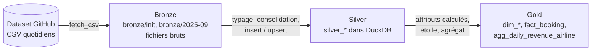
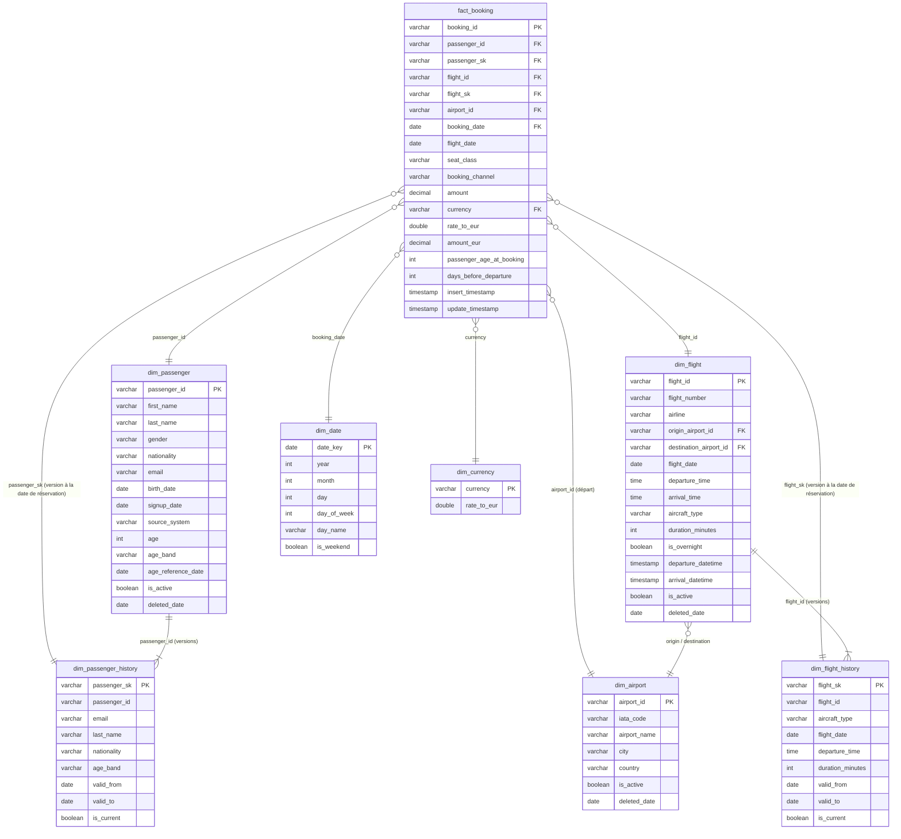
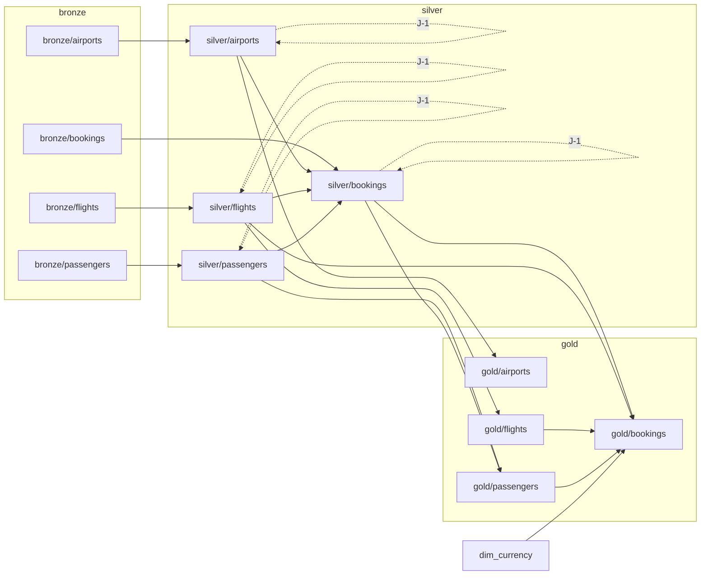

# Documentation — choix de modélisation et de chargement

Ce document justifie les choix faits dans le pipeline : ce qui est un fait, ce qui est une
dimension, comment chaque source est chargée, et les limites connues du modèle.

**Lancer le pipeline** (depuis un clone propre) :

```bash
python -m venv venv && .\venv\Scripts\activate      # source venv/bin/activate sous Linux/macOS
pip install -r requirements.txt
cd ingestion && python run_month.py                  # init + 30 jours de septembre (~30 s)
```

`bronze/` et `warehouse.duckdb` sont entièrement régénérés par ce script.

---

## 1. Ce que l'exploration des données a montré

Les choix qui suivent découlent directement de l'observation des 155 fichiers (init + 30 jours),
en comparant chaque fichier du jour J à celui du jour J-1 :

| Fichier | Clé unique | Contenu d'un fichier journalier | Évolution observée sur 30 jours |
|---|---|---|---|
| `airports` | `airport_id` | **extrait complet** | 1 ajout, 1 nom corrigé, 0 suppression |
| `flights` | `flight_id` | **extrait complet** | 294 ajouts, 21 modifications (horaires, date, avion), 18 suppressions |
| `passengers_en` / `_fr` | `passenger_id` / `id_passager` | **extrait complet** | 421 ajouts, 11 corrections (email, nom, nationalité), 7 suppressions |
| `bookings` | `booking_id` | **uniquement les réservations du jour** | ~39 000 lignes, jamais modifiées ni supprimées |

Autres constats qui ont guidé l'implémentation :

- aucune clé dupliquée, aucune valeur manquante, aucune clé supprimée qui réapparaît ;
- 189 vols sur 696 ont une heure d'arrivée « antérieure » à l'heure de départ : ce sont des
  **vols de nuit** qui arrivent le lendemain ;
- les deux fichiers passagers ont des **noms de colonnes, valeurs de genre (Male/Female vs
  Homme/Femme) et formats de date (`YYYY-MM-DD` vs `DD/MM/YYYY`) différents**, mais des
  identifiants qui ne se chevauchent pas ;
- les montants sont dans 3 devises (EUR ≈ 50 %, USD ≈ 35 %, GBP ≈ 15 %).

## 2. Faits et dimensions

- **`bookings` est le fait.** Une réservation est un **évènement immuable** : elle se produit une
  fois, à une date, et ne change plus. Elle porte la mesure métier (`amount`) et référence les
  autres entités (passager, vol, aéroport).
- **`airports`, `flights`, `passengers` sont des dimensions.** Ce sont des **référentiels qui
  évoluent dans le temps** : ils décrivent le contexte d'une réservation (qui, quel vol, d'où) et
  peuvent être corrigés ou retirés.
- `dim_currency` (fournie) et `dim_date` (construite) complètent le schéma en étoile.

Le grain de la table de fait est **une ligne par réservation**.

## 3. Architecture médaillon



Chaque entité a son script avec 3 fonctions (`ingest_bronze`, `ingest_silver`, `ingest_gold`).
Chaque fonction ne relit que ce que la précédente a **persisté** (fichier sur disque, puis table
silver) : ce sont des tâches indépendantes, rejouables, et prêtes à être orchestrées.

### Bronze: copie brute fidèle

- Le fichier est téléchargé et écrit **octet par octet**, sans passer par pandas : aucune
  transformation (ni guillemets, ni format de nombre, ni encodage). Vérifié : les 155 fichiers
  bronze sont identiques à la source.
- **Cache** : un fichier déjà présent n'est pas retéléchargé. Le bronze permet donc de tout
  rejouer depuis zéro, même hors-ligne (2e passage : 0,5 s au lieu de 48 s).
- **Écriture atomique** (fichier `.tmp` puis renommage) : un téléchargement interrompu ne laisse
  jamais un fichier tronqué qui serait pris pour « déjà téléchargé » au lancement suivant.
- Lecture en `dtype=str` : le bronze n'interprète aucun type, c'est le rôle du silver.

### Silver: données typées, consolidées, à jour

Le silver est l'endroit où l'on **type** les colonnes (`DATE`, `TIME`, `DECIMAL(12,2)`) et où l'on
applique la **stratégie de chargement** propre à chaque source.

#### Dimensions (aéroports, vols, passagers) : upsert + désactivation

La source livre un extrait complet **sans indiquer ce qui a changé**. Les changements sont donc
déduits en comparant le snapshot du jour à l'état du silver, via une fonction commune
(`common.upsert_snapshot`) :

| Situation constatée | Action |
|---|---|
| clé inconnue | **insertion** (`insert_timestamp` = `update_timestamp` = maintenant) |
| clé connue, au moins une valeur différente | **mise à jour** des valeurs + `update_timestamp` |
| clé connue, valeurs identiques | **rien** (la ligne n'est pas retouchée) |
| clé désactivée qui réapparaît | **réactivation** (`is_active = true`, `deleted_date = NULL`) |
| clé active absente du snapshot | **désactivation** : `is_active = false`, `deleted_date` = jour du constat |

Justifications :

- **Pas de suppression physique** : des réservations référencent les vols et passagers disparus
  (774 réservations portent sur 17 vols aujourd'hui désactivés, 64 sur des passagers désactivés).
  Supprimer ces lignes casserait l'intégrité référentielle du modèle.
- **Mise à jour seulement en cas de vrai changement** (comparaison avec `IS DISTINCT FROM`, qui
  gère correctement les `NULL`, contrairement à `<>`). Ainsi `update_timestamp` signifie
  « dernière modification constatée » et rejouer un jour déjà traité ne modifie rien.
  Le squelette fourni pour les aéroports rafraîchissait `update_timestamp` à chaque passage ; il a
  été aligné sur cette logique pour que les trois dimensions aient la même sémantique.
- `insert_timestamp` n'est jamais réécrit : il reste la date de première apparition.
- L'upsert et la désactivation sont exécutés dans **une seule transaction**.

#### Consolidation des passagers EN + FR

Les deux CRM sont fusionnés dans **une seule table `silver_passengers`** au schéma unique :

- renommage des colonnes FR (`id_passager → passenger_id`, `prenom → first_name`, …) ;
- genre normalisé en `M` / `F` depuis `Male/Female` et `Homme/Femme` ;
- dates FR converties depuis `DD/MM/YYYY` (`strptime`) ;
- colonne `source_system` (`EN`/`FR`) pour garder la provenance ;
- simple `UNION ALL`, sans dédoublonnage, puisque les identifiants ne se chevauchent pas.

La désactivation est faite sur l'union des deux sources.

#### Fait (réservations) : insert simple

Le fichier ne contient que les réservations du jour et une réservation ne change jamais : un
upsert n'aurait pas de sens. Le chargement est un **`INSERT … ON CONFLICT DO NOTHING`**, ce qui le
rend idempotent (rejouer un jour ne crée aucun doublon). Surtout, **aucune désactivation** : une
réservation absente du fichier du jour n'a pas disparu, elle a été faite un autre jour.

Un **contrôle qualité** signale toute réservation qui référencerait un passager, un vol ou un
aéroport inconnu en silver (0 sur le mois), sans bloquer le chargement.

### Gold:schéma en étoile

Le gold est **reconstruit** à chaque exécution depuis l'état courant du silver
(`CREATE OR REPLACE`) : il ne dépend d'aucune date, il est donc toujours cohérent avec le silver.
Les colonnes `insert_timestamp` / `update_timestamp` sont reprises du silver.
Les lignes désactivées sont **conservées** dans les dimensions (avec `is_active`), pour que toutes
les réservations restent joignables.



*(Les tables `*_history` reprennent toutes les colonnes de leur dimension courante ; seules les
colonnes utiles à la lecture du diagramme sont affichées. Elles sont détaillées en section 6.)*

*(Toutes les tables silver et gold construites par le pipeline portent aussi `insert_timestamp` et
`update_timestamp`. Seule exception : `dim_currency`, fournie « telle quelle » par
`sql/init/dim_currency.sql` et volontairement non modifiée.)*

Attributs calculés et leurs formules :

- **`dim_flight.duration_minutes`** = `(minutes_arrivée − minutes_départ + 1440) mod 1440`.
  Le modulo 24 h traite les vols de nuit (15:30 → 03:41 = 731 min) : sans lui on obtiendrait une
  durée négative. `is_overnight`, `departure_datetime` et `arrival_datetime` (date d'arrivée
  décalée d'un jour pour les vols de nuit) en découlent. Durées obtenues : 60 à 780 min.
- **`dim_passenger.age_band`** : âge en **années révolues** (`date_sub('year', …)` tient compte du
  jour et du mois de naissance), découpé en tranches `0-17, 18-24, 25-34, 35-44, 45-54, 55-64, 65+`.
  L'âge est calculé à une **date de référence = dernier jour de données chargé** (30/09/2025,
  stockée dans `age_reference_date`) et non à `current_date` : le résultat est reproductible et ne
  dépend pas du jour où l'on lance le pipeline.
- **`fact_booking.amount_eur`** = `amount × dim_currency.rate_to_eur`, arrondi au centime.
- **`fact_booking.passenger_age_at_booking`** : l'âge au moment de la réservation, figé — c'est
  la bonne mesure pour analyser le chiffre d'affaires par âge, l'âge de la dimension évoluant.
- **`fact_booking.days_before_departure`** : délai entre réservation et vol (0 à 57 jours).

`dim_date` couvre toutes les dates de réservation **et** de vol (01/08 → 12/10/2025, des vols
réservés en septembre partant en octobre). Une date ne changeant jamais, elle est chargée en
insert idempotent plutôt que reconstruite.

#### Table d'agrégation `agg_daily_revenue_airline`

Chiffre d'affaires par **jour de réservation et par compagnie** : `nb_bookings`, `revenue_eur`,
`avg_amount_eur`. Elle est construite à la fin du `ingest_gold` des réservations : c'est la
dernière étape gold de la boucle quotidienne (`run_month.py` exécute le gold des vols avant celui
des réservations), donc `fact_booking` et `dim_flight` sont déjà à jour. Contrôle : la somme de
l'agrégat est égale à la somme de `fact_booking.amount_eur`.

Le gold vérifie aussi l'invariant annoncé par la source : `airport_id` d'une réservation =
aéroport de départ du vol réservé (0 incohérence).

## 4. Idempotence

Toutes les fonctions sont rejouables sans effet de bord : relancer un jour déjà traité ne crée
aucun doublon et ne modifie aucune ligne (vérifié en relançant le 30/09 puis le mois entier).

## 5. Limites connues

- **Historique limité au mois observé** : l'historique SCD2 (section 6) commence avec `init/`. On
  ne connaît pas les versions antérieures au 31/08/2025 : l'état initial est réputé valide depuis
  toujours (`valid_from = 1900-01-01`). Les aéroports, quasi figés, ne sont pas historisés.
- **Granularité journalière** : la source livre un état par jour ; deux changements le même jour
  ne seraient vus que comme un seul, et l'heure exacte d'un changement est inconnue.
- **`days_before_departure` utilise la date de vol actuelle** (`dim_flight`), c'est-à-dire la date à
  laquelle le passager part réellement si le vol a été décalé. La date prévue au moment de la
  réservation reste disponible via `flight_sk` → `dim_flight_history.flight_date`.
- **Ordre chronologique supposé** : chaque snapshot est traité comme l'état de vérité du moment.
  Pour les tables d'état courant, rejouer un jour *ancien* après un jour plus récent ramènerait
  temporairement les dimensions à cet état ancien (rejouer le mois complet dans l'ordre redonne le
  bon état final). L'historique SCD2, lui, est protégé par un garde-fou (section 6).
- **Fuseaux horaires ignorés** : la source ne donne pas de fuseau ; les durées supposent que départ
  et arrivée sont exprimés dans le même référentiel horaire, et qu'aucun vol ne dure plus de 24 h.
- **Taux de change fixes** (fournis) : `amount_eur` ne reflète pas le taux du jour de la réservation.
- **Cache bronze figé** : si la source corrigeait un fichier déjà téléchargé, la correction ne
  serait pas reprise (il faudrait supprimer le fichier de `bronze/`).
- **Désactivation globale** : un fichier source vide ou tronqué un jour donné désactiverait toutes
  les lignes absentes. Un vrai pipeline ajouterait un garde-fou (ex. refuser un snapshot dont la
  taille chute brutalement).

## 6. Bonus: historisation complète (SCD2) des vols et des passagers

Les tables `dim_flight` / `dim_passenger` (SCD de type 1) ne gardent que l'état courant : quand un
vol change d'avion, l'ancienne valeur est écrasée. Pour répondre à des questions comme *« quel
avion était affecté à tel vol à telle date ? »*, chaque **version** est conservée dans une table
d'historique, à côté des tables d'état courant (qui restent les plus simples à interroger).

| Couche | Vols | Passagers |
|---|---|---|
| silver | `silver_flights_history` | `silver_passengers_history` |
| gold | `dim_flight_history` (+ durée, vol de nuit…) | `dim_passenger_history` (+ âge, tranche d'âge) |

Les deux dimensions historisées sont celles qui changent réellement (21 vols et 11 passagers
modifiés sur le mois) ; les aéroports (1 seule correction) restent en SCD1.

### Principe

Chaque version a une **période de validité `[valid_from, valid_to[`** (début inclus, fin exclue,
`valid_to = 9999-12-31` et `is_current = true` pour la version en cours) et une **clé de
substitution** `flight_sk` / `passenger_sk` = `<clé naturelle>@<valid_from>`, déterministe (elle est
identique à chaque reconstruction) et unique (une clé a au plus une version par jour).

Pour chaque snapshot du jour D (`common.apply_scd2`), dans une transaction :

1. **fermeture** de la version en cours (`valid_to = D`, `is_current = false`) si ses valeurs
   diffèrent du snapshot (**modification**) ou si la clé a disparu (**suppression** : la version est
   close sans successeur, ce qui équivaut au `is_active = false` du SCD1) ;
2. **ouverture** d'une version `[D, 9999-12-31[` pour toute clé du snapshot sans version en cours
   (nouvelle clé, clé modifiée qui vient d'être close, clé qui réapparaîtrait).

Pourquoi `valid_from = D` : le snapshot du jour D décrit l'état de la source **le jour D**, et la
source garantit que les réservations du jour D référencent les vols et passagers tels qu'ils sont
dans les fichiers du jour D. Une réservation faite le jour D doit donc voir la version issue du
snapshot D.

### Lien avec le fait

`fact_booking` porte, en plus des clés naturelles (état courant), `flight_sk` et `passenger_sk` :
la version **valide le jour de la réservation** (`valid_from <= booking_date < valid_to`).
Exemple réel : le vol F0141 était un Airbus A321 jusqu'au 07/09 puis un A330 à partir du 08/09 ;
ses 25 réservations antérieures pointent vers la version A321, les 65 suivantes vers la version
A330. Au total, 1 553 réservations pointent vers une version de vol qui n'est plus la version
courante : c'est l'information que le SCD1 seul perdait.

```sql
-- Quel avion était affecté au vol F0141 le 05/09/2025 ?
SELECT aircraft_type
FROM dim_flight_history
WHERE flight_id = 'F0141'
  AND DATE '2025-09-05' >= valid_from AND DATE '2025-09-05' < valid_to;   -- Airbus A321
```

### Idempotence : un garde-fou spécifique

L'upsert SCD1 est naturellement rejouable, pas l'historisation : rejouer un jour *ancien* après un
jour plus récent fermerait des versions dans le passé et corromprait l'historique. Le dernier
snapshot historisé est donc mémorisé par table (`silver_scd2_watermark`) et tout snapshot daté de
ce jour ou d'avant est ignoré par l'historisation. Vérifié : rejouer le mois complet laisse
l'historique strictement identique.

### Contrôles

Vérifiés sur le mois (et contrôlés automatiquement dans `ingest_gold` pour le fait) :

- 735 versions pour 714 vols, 2 232 versions pour 2 221 passagers ;
- versions en cours = lignes actives du SCD1 (696 vols, 2 214 passagers) et clés sans version en
  cours = lignes désactivées (18 vols, 7 passagers) : les deux modèles sont cohérents ;
- **aucun chevauchement ni trou** entre les versions successives d'une même clé ;
- **chaque réservation trouve exactement une version** de vol et de passager.

## 7. Bonus — orchestration avec Dagster

Le dossier `orchestration/` remplace `run_month.py` par un pipeline Dagster. `run_month.py` reste
utilisable tel quel ; Dagster n'est nécessaire que pour ce bonus (`requirements-dagster.txt`).

```bash
pip install -r requirements-dagster.txt
cd orchestration
dagster dev          # puis http://localhost:3000
```

Dans l'interface : **Assets → Materialize all → toutes les partitions** lance le backfill complet
(init + 30 jours), l'équivalent exact de `run_month.py`.

### Assets

**Une fonction = un asset** : chaque `ingest_bronze` / `ingest_silver` / `ingest_gold` des 4
scripts devient un asset (`bronze/flights`, `silver/flights`, `gold/flights`, …), soit 12 assets,
plus `dim_currency` (non partitionné, exécute `sql/init/dim_currency.sql` une fois). Le code
d'ingestion n'est pas dupliqué : les assets appellent les fonctions existantes. Chaque asset
silver / gold affiche en métadonnées le nombre de lignes des tables qu'il produit.

Les assets sont rangés en groupes `bronze`, `silver`, `gold` (et `init` pour `dim_currency`), ce
qui rend l'architecture médaillon directement visible dans le graphe de l'interface.

### Partitions quotidiennes

`DailyPartitionsDefinition` du **2025-08-31 au 2025-09-30** (31 partitions). La partition
**2025-08-31 représente l'état initial** (`init/`, données jusqu'au 31/08, date déjà utilisée
comme date de snapshot de l'init dans le code), les 30 autres les jours de septembre.

### Dépendances



- Les dépendances suivent les **données réellement lues** : le silver des réservations contrôle
  les références vers les 3 dimensions du même jour, le gold des passagers lit `silver_bookings`
  (date de référence de l'âge), le gold des réservations lit `dim_flight`, `dim_passenger`,
  `dim_currency` et `silver_flights` (bornes de `dim_date`). C'est la contrainte que `run_month.py`
  traduisait par son ordre « bronze des 4, puis silver des 4, puis gold des 4 ».
- **Chaque asset silver dépend de sa propre partition de la veille** (pointillés `J-1`,
  `TimeWindowPartitionMapping(start_offset=-1, end_offset=-1)`). Le silver est un état cumulatif
  (upsert, désactivations, historique SCD2) : charger le 15/09 avant le 14/09 corromprait l'état.
  Avec cette auto-dépendance, Dagster ne lance jamais un jour dont la veille n'est ni chargée ni
  demandée dans le même backfill.

### Un backfill = un run par niveau, pas un run par jour

Premier essai sans politique de backfill : Dagster découpait le backfill **asset par asset et jour
par jour**, soit environ 170 petits runs et plus de 30 minutes, avec des jours qui n'avançaient pas
ensemble (le silver des aéroports au 17/09 alors que celui des réservations n'avait pas commencé
le 31/08). Le résultat final restait correct grâce aux dépendances, mais ce n'était ni efficace ni
fidèle à `run_month.py`.

Tous les assets partitionnés ont donc une **`BackfillPolicy.single_run()`** : chaque asset reçoit
la **plage complète** des jours demandés dans un seul run.

- **bronze / silver** bouclent sur ces jours **dans l'ordre chronologique** (`sorted(context.partition_keys)`) ;
- **gold** n'est reconstruit qu'**une seule fois**, à la fin : il ne dépend que de l'état courant
  du silver, pas d'une date (c'est sa définition dans le sujet), le refaire pour chaque jour
  intermédiaire serait inutile ;
- une matérialisation d'un seul jour (usage quotidien) est simplement une plage de longueur 1.

### Accès concurrent à DuckDB

DuckDB n'accepte qu'un processus écrivain à la fois sur `warehouse.duckdb`. Deux réglages évitent
tout conflit :

- **exécuteur in-process** (`Definitions(executor=in_process_executor)`) : les assets d'un même run
  s'exécutent l'un après l'autre dans un seul processus ;
- **un seul run à la fois** (`orchestration/dagster.yaml`, `max_concurrent_runs: 1`) : les runs
  passent par la file d'attente de Dagster. Les niveaux du pipeline étant de toute façon
  séquentiels (dépendances), on ne perd pas de parallélisme utile.

### Vérification

- Sur un entrepôt et un bronze **vides**, le backfill complet des 31 partitions se termine en
  `COMPLETED_SUCCESS` en **5 runs** (bronze ; `dim_currency` ; aéroports ; vols + passagers ;
  réservations), chacun couvrant toute la plage du 31/08 au 30/09 — environ 4 min 30, dont le
  téléchargement des 155 fichiers et l'attente entre runs gérée par le démon Dagster.
- Il produit **exactement les mêmes tables** que `run_month.py` : contenu identique pour
  `dim_flight`, `dim_passenger`, `dim_date`, `fact_booking`, `agg_daily_revenue_airline` et les
  tables d'historique SCD2 (comparaison de toutes les colonnes hors horodatages techniques).
- Rematérialiser ensuite la seule partition du 30/09 ne modifie **aucune** table.

### Limites

- Le stockage de l'instance Dagster est temporaire (supprimé à l'arrêt de `dagster dev`) ; pour
  garder l'historique des runs, définir la variable `DAGSTER_HOME`.
- Rematérialiser une partition **ancienne** isolément (et non tout le backfill) relance le chargement
  de ce jour : les tables d'état courant reviendraient temporairement à cet état (cf. section 5),
  l'historique SCD2 restant protégé par son garde-fou.
