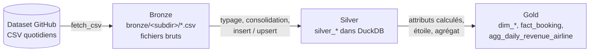
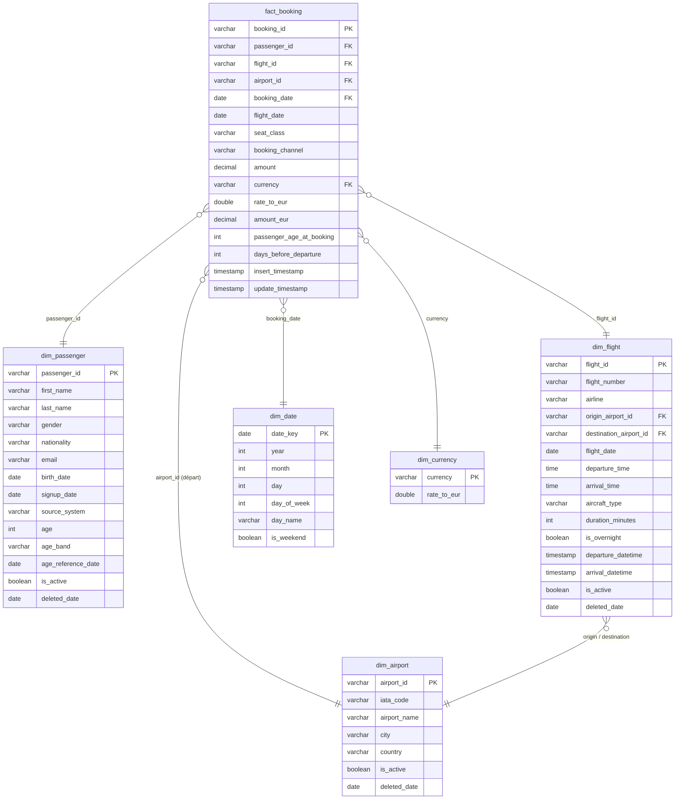

# Documentation — choix de modélisation et de chargement

Ce document justifie les choix faits dans le pipeline : ce qui est un fait, ce qui est une
dimension, comment chaque source est chargée, et les limites connues du modèle.

**Lancer le pipeline** (depuis un clone propre) :

```bash
python -m venv venv && .\venv\Scripts\activate      # source venv/bin/activate sous Linux/macOS
pip install -r requirements.txt
cd ingestion && python run_month.py                  # init + 30 jours de septembre (~30 s)
```

`bronze/` et `warehouse.duckdb` sont entièrement régénérés par ce script.

---

## 1. Ce que l'exploration des données a montré

Les choix qui suivent découlent directement de l'observation des 155 fichiers (init + 30 jours),
en comparant chaque fichier du jour J à celui du jour J-1 :

| Fichier | Clé unique | Contenu d'un fichier journalier | Évolution observée sur 30 jours |
|---|---|---|---|
| `airports` | `airport_id` | **extrait complet** | 1 ajout, 1 nom corrigé, 0 suppression |
| `flights` | `flight_id` | **extrait complet** | 294 ajouts, 21 modifications (horaires, date, avion), 18 suppressions |
| `passengers_en` / `_fr` | `passenger_id` / `id_passager` | **extrait complet** | 421 ajouts, 11 corrections (email, nom, nationalité), 7 suppressions |
| `bookings` | `booking_id` | **uniquement les réservations du jour** | ~39 000 lignes, jamais modifiées ni supprimées |

Autres constats qui ont guidé l'implémentation :

- aucune clé dupliquée, aucune valeur manquante, aucune clé supprimée qui réapparaît ;
- 189 vols sur 696 ont une heure d'arrivée « antérieure » à l'heure de départ : ce sont des
  **vols de nuit** qui arrivent le lendemain ;
- les deux fichiers passagers ont des **noms de colonnes, valeurs de genre (Male/Female vs
  Homme/Femme) et formats de date (`YYYY-MM-DD` vs `DD/MM/YYYY`) différents**, mais des
  identifiants qui ne se chevauchent pas ;
- les montants sont dans 3 devises (EUR ≈ 50 %, USD ≈ 35 %, GBP ≈ 15 %).

## 2. Faits et dimensions

- **`bookings` est le fait.** Une réservation est un **évènement immuable** : elle se produit une
  fois, à une date, et ne change plus. Elle porte la mesure métier (`amount`) et référence les
  autres entités (passager, vol, aéroport).
- **`airports`, `flights`, `passengers` sont des dimensions.** Ce sont des **référentiels qui
  évoluent dans le temps** : ils décrivent le contexte d'une réservation (qui, quel vol, d'où) et
  peuvent être corrigés ou retirés.
- `dim_currency` (fournie) et `dim_date` (construite) complètent le schéma en étoile.

Le grain de la table de fait est **une ligne par réservation**.

## 3. Architecture médaillon



Chaque entité a son script avec 3 fonctions (`ingest_bronze`, `ingest_silver`, `ingest_gold`).
Chaque fonction ne relit que ce que la précédente a **persisté** (fichier sur disque, puis table
silver) : ce sont des tâches indépendantes, rejouables, et prêtes à être orchestrées.

### Bronze — copie brute fidèle

- Le fichier est téléchargé et écrit **octet par octet**, sans passer par pandas : aucune
  transformation (ni guillemets, ni format de nombre, ni encodage). Vérifié : les 155 fichiers
  bronze sont identiques à la source.
- **Cache** : un fichier déjà présent n'est pas retéléchargé. Le bronze permet donc de tout
  rejouer depuis zéro, même hors-ligne (2e passage : 0,5 s au lieu de 48 s).
- **Écriture atomique** (fichier `.tmp` puis renommage) : un téléchargement interrompu ne laisse
  jamais un fichier tronqué qui serait pris pour « déjà téléchargé » au lancement suivant.
- Lecture en `dtype=str` : le bronze n'interprète aucun type, c'est le rôle du silver.

### Silver — données typées, consolidées, à jour

Le silver est l'endroit où l'on **type** les colonnes (`DATE`, `TIME`, `DECIMAL(12,2)`) et où l'on
applique la **stratégie de chargement** propre à chaque source.

#### Dimensions (aéroports, vols, passagers) : upsert + désactivation

La source livre un extrait complet **sans indiquer ce qui a changé**. Les changements sont donc
déduits en comparant le snapshot du jour à l'état du silver, via une fonction commune
(`common.upsert_snapshot`) :

| Situation constatée | Action |
|---|---|
| clé inconnue | **insertion** (`insert_timestamp` = `update_timestamp` = maintenant) |
| clé connue, au moins une valeur différente | **mise à jour** des valeurs + `update_timestamp` |
| clé connue, valeurs identiques | **rien** (la ligne n'est pas retouchée) |
| clé désactivée qui réapparaît | **réactivation** (`is_active = true`, `deleted_date = NULL`) |
| clé active absente du snapshot | **désactivation** : `is_active = false`, `deleted_date` = jour du constat |

Justifications :

- **Pas de suppression physique** : des réservations référencent les vols et passagers disparus
  (774 réservations portent sur 17 vols aujourd'hui désactivés, 64 sur des passagers désactivés).
  Supprimer ces lignes casserait l'intégrité référentielle du modèle.
- **Mise à jour seulement en cas de vrai changement** (comparaison avec `IS DISTINCT FROM`, qui
  gère correctement les `NULL`, contrairement à `<>`). Ainsi `update_timestamp` signifie
  « dernière modification constatée » et rejouer un jour déjà traité ne modifie rien.
  Le squelette fourni pour les aéroports rafraîchissait `update_timestamp` à chaque passage ; il a
  été aligné sur cette logique pour que les trois dimensions aient la même sémantique.
- `insert_timestamp` n'est jamais réécrit : il reste la date de première apparition.
- L'upsert et la désactivation sont exécutés dans **une seule transaction**.

#### Consolidation des passagers EN + FR

Les deux CRM sont fusionnés dans **une seule table `silver_passengers`** au schéma unique :

- renommage des colonnes FR (`id_passager → passenger_id`, `prenom → first_name`, …) ;
- genre normalisé en `M` / `F` depuis `Male/Female` et `Homme/Femme` ;
- dates FR converties depuis `DD/MM/YYYY` (`strptime`) ;
- colonne `source_system` (`EN`/`FR`) pour garder la provenance ;
- simple `UNION ALL`, sans dédoublonnage, puisque les identifiants ne se chevauchent pas.

La désactivation est faite sur l'union des deux sources.

#### Fait (réservations) : insert simple

Le fichier ne contient que les réservations du jour et une réservation ne change jamais : un
upsert n'aurait pas de sens. Le chargement est un **`INSERT … ON CONFLICT DO NOTHING`**, ce qui le
rend idempotent (rejouer un jour ne crée aucun doublon). Surtout, **aucune désactivation** : une
réservation absente du fichier du jour n'a pas disparu, elle a été faite un autre jour.

Un **contrôle qualité** signale toute réservation qui référencerait un passager, un vol ou un
aéroport inconnu en silver (0 sur le mois), sans bloquer le chargement.

### Gold — schéma en étoile

Le gold est **reconstruit** à chaque exécution depuis l'état courant du silver
(`CREATE OR REPLACE`) : il ne dépend d'aucune date, il est donc toujours cohérent avec le silver.
Les colonnes `insert_timestamp` / `update_timestamp` sont reprises du silver.
Les lignes désactivées sont **conservées** dans les dimensions (avec `is_active`), pour que toutes
les réservations restent joignables.



*(Toutes les tables gold portent aussi `insert_timestamp` et `update_timestamp`.)*

Attributs calculés et leurs formules :

- **`dim_flight.duration_minutes`** = `(minutes_arrivée − minutes_départ + 1440) mod 1440`.
  Le modulo 24 h traite les vols de nuit (15:30 → 03:41 = 731 min) : sans lui on obtiendrait une
  durée négative. `is_overnight`, `departure_datetime` et `arrival_datetime` (date d'arrivée
  décalée d'un jour pour les vols de nuit) en découlent. Durées obtenues : 60 à 780 min.
- **`dim_passenger.age_band`** : âge en **années révolues** (`date_sub('year', …)` tient compte du
  jour et du mois de naissance), découpé en tranches `0-17, 18-24, 25-34, 35-44, 45-54, 55-64, 65+`.
  L'âge est calculé à une **date de référence = dernier jour de données chargé** (30/09/2025,
  stockée dans `age_reference_date`) et non à `current_date` : le résultat est reproductible et ne
  dépend pas du jour où l'on lance le pipeline.
- **`fact_booking.amount_eur`** = `amount × dim_currency.rate_to_eur`, arrondi au centime.
- **`fact_booking.passenger_age_at_booking`** : l'âge au moment de la réservation, figé — c'est
  la bonne mesure pour analyser le chiffre d'affaires par âge, l'âge de la dimension évoluant.
- **`fact_booking.days_before_departure`** : délai entre réservation et vol (0 à 57 jours).

`dim_date` couvre toutes les dates de réservation **et** de vol (01/08 → 12/10/2025, des vols
réservés en septembre partant en octobre). Une date ne changeant jamais, elle est chargée en
insert idempotent plutôt que reconstruite.

#### Table d'agrégation `agg_daily_revenue_airline`

Chiffre d'affaires par **jour de réservation et par compagnie** : `nb_bookings`, `revenue_eur`,
`avg_amount_eur`. Elle est construite à la fin du `ingest_gold` des réservations : c'est la
dernière étape gold de la boucle quotidienne (`run_month.py` exécute le gold des vols avant celui
des réservations), donc `fact_booking` et `dim_flight` sont déjà à jour. Contrôle : la somme de
l'agrégat est égale à la somme de `fact_booking.amount_eur`.

Le gold vérifie aussi l'invariant annoncé par la source : `airport_id` d'une réservation =
aéroport de départ du vol réservé (0 incohérence).

## 4. Idempotence

Toutes les fonctions sont rejouables sans effet de bord : relancer un jour déjà traité ne crée
aucun doublon et ne modifie aucune ligne (vérifié en relançant le 30/09 puis le mois entier).

## 5. Limites connues

- **Pas d'historique des dimensions (SCD de type 1)** : quand un vol change d'horaire ou d'avion,
  seule la valeur courante est gardée. On ne peut pas savoir quel avion était affecté à un vol à
  une date passée, et `days_before_departure` utilise la date de vol *actuelle*.
- **Ordre chronologique supposé** : chaque snapshot est traité comme l'état de vérité du moment.
  Rejouer un jour *ancien* après un jour plus récent ramènerait temporairement les dimensions à cet
  état ancien (rejouer le mois complet dans l'ordre redonne le bon état final).
- **Fuseaux horaires ignorés** : la source ne donne pas de fuseau ; les durées supposent que départ
  et arrivée sont exprimés dans le même référentiel horaire, et qu'aucun vol ne dure plus de 24 h.
- **Taux de change fixes** (fournis) : `amount_eur` ne reflète pas le taux du jour de la réservation.
- **Cache bronze figé** : si la source corrigeait un fichier déjà téléchargé, la correction ne
  serait pas reprise (il faudrait supprimer le fichier de `bronze/`).
- **Désactivation globale** : un fichier source vide ou tronqué un jour donné désactiverait toutes
  les lignes absentes. Un vrai pipeline ajouterait un garde-fou (ex. refuser un snapshot dont la
  taille chute brutalement).
